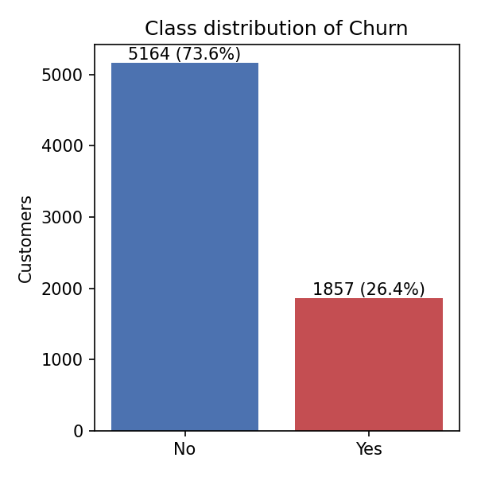
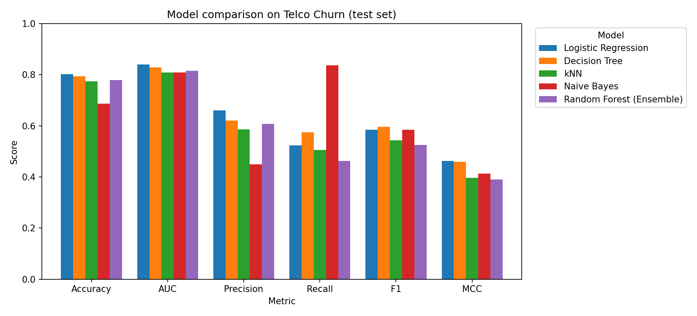

# Telco Customer Churn: Classification Model Comparison

## a. Problem Statement

Telecom companies lose revenue whenever a customer cancels their service, and keeping an existing customer is usually cheaper than winning a new one. The goal of this project is to predict whether a customer will churn (leave the company) using their account details, subscribed services and billing information. Five classification models (Logistic Regression, Decision Tree, kNN, Naive Bayes and Random Forest) are trained on the same preprocessed data and compared using six evaluation metrics, so that the most suitable model for churn prediction can be identified.

## b. Dataset Description

- **Source:** Telco Customer Churn dataset (IBM sample data), downloaded from Kaggle.
- **Why this dataset was chosen:** It meets all the assignment requirements (more than 12 features, more than 1,000 rows, missing values to handle, class imbalance to examine). It represents a realistic business problem, it has a good mix of numeric and categorical features that need different preprocessing, and its missing values are hidden in a text column, which makes data cleaning a genuine part of the task.
- **Size:** 7,043 rows and 21 columns (20 features + 1 target). After removing 22 duplicate rows, 7,021 rows remain.
- **Target variable:** `Churn` (Yes = 1, No = 0). This is a binary classification problem.
- **Feature types:**
  - Numeric: `tenure`, `MonthlyCharges`, `TotalCharges`
  - Binary (already 0/1): `SeniorCitizen`
  - Categorical (15): `gender`, `Partner`, `Dependents`, `PhoneService`, `MultipleLines`, `InternetService`, `OnlineSecurity`, `OnlineBackup`, `DeviceProtection`, `TechSupport`, `StreamingTV`, `StreamingMovies`, `Contract`, `PaperlessBilling`, `PaymentMethod`
  - Dropped: `customerID` (unique identifier, no predictive value)
- **Missing values:** `TotalCharges` is stored as text because 11 entries are blank spaces, so `isnull()` initially reports no missing values. After converting the column to numeric, 11 missing values appear. All of them belong to customers with `tenure = 0`, meaning new customers who have not been billed yet.
- **Class distribution:** The dataset is imbalanced: 5,174 customers stayed (73.5%) and 1,869 churned (26.5%) in the original data. A model that always predicts "No churn" would reach about 73.5% accuracy without learning anything, so accuracy alone is not a reliable measure here.



## Preprocessing

1. Dropped the `customerID` column.
2. Converted `TotalCharges` to numeric (blanks became NaN).
3. Removed 22 duplicate rows.
4. Encoded the target: Yes = 1, No = 0.
5. Split the data 80:20 into train and test sets using a stratified split (`stratify=y`) with `random_state=42`. Churn rate: 26.4% in train and 26.5% in test.
6. Preprocessing was fitted **only on the training data** and then applied to the test data:
   - Numeric columns: median imputation, then `StandardScaler`
   - Categorical columns: `OneHotEncoder` (`handle_unknown="ignore"`)
   - `SeniorCitizen` passed through unchanged
7. The final feature matrix has 45 columns.

## Model Configurations

| Model | Configuration |
|---|---|
| Logistic Regression | `max_iter=1000`, `random_state=42` |
| Decision Tree | `max_depth=5`, `random_state=42` |
| kNN | `n_neighbors=11` |
| Naive Bayes | `GaussianNB()` (default settings) |
| Random Forest (Ensemble) | `n_estimators=200`, `random_state=42` |

## c. GitHub Repository

https://github.com/Anjali-pandit05113/telco-churn-classification/tree/main

Repository contents:

```
project-folder/
|-- requirements.txt
|-- README.md
|-- test_data.csv
|-- class_distribution.png
|-- metrics_comparison.png
|-- results_table.csv
|-- model/
    |-- (notebook with all five models)
```

## d. Models Used

All five models were trained on the same training data and evaluated on the same test set (1,405 rows). Precision, Recall and F1 are calculated for the churn class (class 1). AUC is calculated from predicted probabilities.

| ML Model Name | Accuracy | AUC | Precision | Recall | F1 | MCC |
|---|---|---|---|---|---|---|
| Logistic Regression | 0.8028 | 0.8403 | 0.6610 | 0.5242 | 0.5847 | 0.4630 |
| Decision Tree | 0.7943 | 0.8287 | 0.6203 | 0.5753 | 0.5969 | 0.4597 |
| kNN | 0.7744 | 0.8091 | 0.5857 | 0.5054 | 0.5426 | 0.3958 |
| Naive Bayes | 0.6861 | 0.8092 | 0.4501 | 0.8360 | 0.5851 | 0.4132 |
| Random Forest (Ensemble) | 0.7786 | 0.8161 | 0.6078 | 0.4624 | 0.5252 | 0.3904 |

### Metrics in graph form



### Observations

| ML Model Name | Observation about model performance |
|---|---|
| Logistic Regression | Best overall on Accuracy (0.8028), AUC (0.8403), Precision (0.6610) and MCC (0.4630). Its accuracy is about 6.7 points above the 73.5% majority-class baseline, so it is genuinely learning. Recall (0.5242) is only moderate, so it still misses nearly half of the customers who churn. A linear model works well here because churn depends strongly on a few features such as contract type and tenure, and the data is mostly one-hot columns. |
| Decision Tree | Highest F1 (0.5969) and the second-best Recall (0.5753) among the non-Naive-Bayes models, with a competitive Accuracy of 0.7943 and an MCC (0.4597) almost equal to Logistic Regression. Limiting the depth to 5 keeps the tree from overfitting. It gives up a little Precision and AUC compared with Logistic Regression but finds more of the churners, and its rules are easy to interpret. |
| kNN | Weaker than the top models, with the lowest AUC (0.8091) and a low MCC (0.3958). Recall (0.5054) is also modest. kNN depends on distances, and with 45 columns, most of them sparse one-hot indicators, distances become less informative, so neighbours are less reliable. It is also sensitive to the choice of k and to scaling. |
| Naive Bayes | Very different from the rest: the highest Recall (0.8360) but the lowest Precision (0.4501) and the lowest Accuracy (0.6861), which is below the 73.5% baseline. It labels many customers as churners, catching most real churners at the cost of many false alarms. Its assumption that features are independent is violated here, since one-hot columns such as "No internet service" repeat across several features. Its AUC (0.8092) shows the ranking is reasonable even though its default cut-off is badly placed. It may suit a company that wants to catch as many churners as possible and finds retention offers cheap. |
| Random Forest (Ensemble) | Accuracy (0.7786) and AUC (0.8161) are decent, but it has the lowest Recall (0.4624) and the lowest MCC (0.3904), so it misses more than half of the churners. With imbalanced classes and the default 0.5 threshold, the forest leans toward predicting the majority class (No churn). It was not tuned in this project, and tuning the number of trees, tree depth or the decision threshold could improve it. |
| **Overall winner for this dataset** | **Logistic Regression.** It has the best Accuracy, AUC, Precision and MCC, which is the most balanced single measure when classes are imbalanced. It is also simple, fast and interpretable. If the business goal is to catch as many churners as possible regardless of false alarms, Naive Bayes (Recall 0.836) or the Decision Tree (best F1) could be preferred. |

## How to Run

1. Install the dependencies:
   ```
   pip install -r requirements.txt
   ```
2. Place `telco_churn.csv` (the Kaggle dataset) in the project folder.
3. Open the notebook in the `model/` folder and run all cells from top to bottom.
4. The notebook saves `test_data.csv`, `results_table.csv`, `class_distribution.png` and `metrics_comparison.png`.
